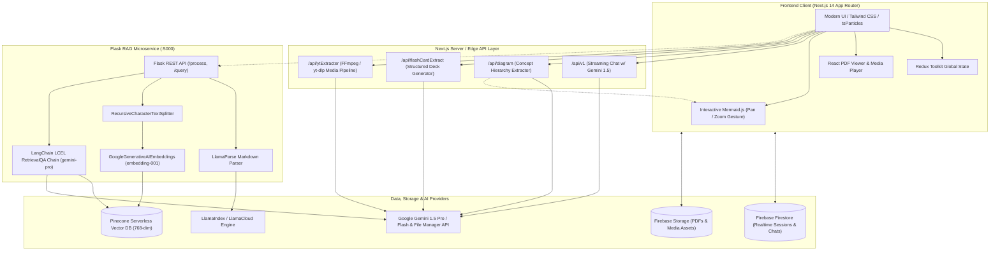

# Learnability 2.0 🧠⚡

<p align="center">
  
  
  
  
  
  
  
  
</p>

---

## 📌 Executive Overview

**Learnability 2.0** is an enterprise-grade multimodal AI learning platform engineered to transform dense educational media—academic PDFs, multi-column research papers, tabular course materials, and long-form video lectures—into interactive, structured knowledge ecosystems.

By unifying a high-throughput **Next.js 14** full-stack interface with an asynchronous **Python Flask RAG microservice**, Learnability 2.0 combines **LlamaParse** deep document understanding, **Pinecone** vector embeddings, **Google Gemini 1.5 Pro & Flash** multimodal reasoning, **FFmpeg / yt-dlp** automated media pipelines, and dynamic client-side **Mermaid.js** concept graph rendering with gesture-driven pan-and-zoom exploration.

---

## 🏗️ System Architecture



---

## ⚡ Core Features

### 📄 Advanced Document Parsing with LlamaParse
- **Structure-Aware Ingestion**: Handles complex non-linear layouts, multi-column scientific publications, embedded screenshots, equations, and tables that traditional OCR engines corrupt.
- **Markdown Normalization**: Automatically converts unstructured pages into semantic Markdown blocks ready for deterministic chunking and high-precision RAG indexing.

### 🌐 Dynamic Streaming Concept Hierarchies (Mermaid.js)
- **Automated Knowledge Synthesis**: Converts complex lecture transcriptions and PDF chapters into interactive Mermaid.js mind maps and relational knowledge graphs.
- **Gesture-Driven Canvas**: Native pinch-to-zoom and pan support using `react-use-gesture`, enabling users to navigate expansive thematic trees effortlessly.

### 🎥 Multimodal Lecture Ingestion Pipeline (FFmpeg & yt-dlp)
- **Audio Demuxing & Extraction**: Extracts high-fidelity audio streams from YouTube lectures or uploaded video files using local `yt-dlp` and `ffmpeg` binaries.
- **Multimodal AI Processing**: Uploads audio tracks directly via the Google AI File Manager API to `gemini-1.5-pro` for automated timestamping, comprehensive chapter breakdowns, and contextual QA.

### 🗄️ Hybrid RAG with LangChain & Pinecone
- **Serverless Vector Storage**: Indexes chunks in Pinecone with 768-dimensional Google embeddings using cosine similarity.
- **Context-Bound Synthesis**: Employs LangChain Expression Language (LCEL) retrieval chains to eliminate hallucinations and constrain model responses strictly to verified syllabus materials.

### 🃏 Automated Flashcard Generation & Active Recall
- **Structured JSON Synthesis**: Automatically extracts key principles, definitions, and formulas into interactive study decks using Gemini 1.5 schema validation.
- **Dedicated Revision Mode**: Interactive review workflows that prompt students with targeted questions based on their session history and note archives.

### 🔄 Resilient Multi-Key Rotation
- Round-robin Google Gemini API key orchestration across fallback credentials (`API_KEY`, `API_KEY2`, `API_KEY3`, `API_KEY4`, `API_KEY5`) to mitigate token-per-minute (TPM) throttling during intensive classroom loads.

---

## 🛠️ Tech Stack

| Domain | Technology | Purpose |
| :--- | :--- | :--- |
| **Frontend Framework** | [Next.js 14 (App Router)](https://nextjs.org/) | React Server Components, server actions, client routes |
| **State Management** | [Redux Toolkit](https://redux-toolkit.js.org/) | Global authentication, session state, UI theme colors |
| **Styling & Effects** | [Tailwind CSS](https://tailwindcss.com/) / [tsParticles](https://particles.js.org/) | Responsive interface design and animated ambient canvas |
| **Visual Graphs** | [Mermaid.js](https://mermaid.js.org/) / [react-use-gesture](https://use-gesture.netlify.app/) | Interactive mind maps with zoom & drag interactions |
| **Document Viewer** | [@react-pdf-viewer/core](https://react-pdf-viewer.dev/) | In-browser PDF navigation with synchronized text reading |
| **Backend Microservice**| [Python Flask 3.0](https://flask.palletsprojects.com/) | Dedicated asynchronous RAG and document processing service |
| **RAG & Orchestration** | [LangChain](https://python.langchain.com/) | LCEL chains, text splitters, prompt templates |
| **Document Ingestion** | [LlamaParse](https://cloud.llamaindex.ai/) | High-accuracy layout-aware PDF and table parsing |
| **Vector Database** | [Pinecone Serverless](https://www.pinecone.io/) | 768-dimensional dense vector indexing and retrieval |
| **LLMs & Embeddings** | [Google Gemini 1.5 Pro / Flash](https://ai.google.dev/) | Multimodal reasoning, streaming inference, text embeddings |
| **Media Extraction** | [FFmpeg](https://ffmpeg.org/) & [yt-dlp](https://github.com/yt-dlp/yt-dlp) | YouTube audio scraping, format conversions, stream slicing |
| **Identity & Database**| [Firebase Auth / Firestore / Storage](https://firebase.google.com/) | Real-time session synchronization, secure auth, asset storage |

---

## 📂 Directory Structure

```plaintext
Learnability_2.0/
├── package.json                    # Root workspace script orchestrator (concurrently)
├── package-lock.json
│
├── flaskBackend/                   # Python Flask RAG Microservice
│   ├── app.py                      # Flask app with LlamaParse, Pinecone, & LangChain RAG
│   ├── requirements.txt            # Python dependencies (Flask, LangChain, Pinecone, LlamaParse)
│   ├── .flaskenv                   # Flask runtime configuration (FLASK_APP, FLASK_DEBUG)
│   ├── .gitignore
│   └── Unit 5 Notes_...pdf         # Sample evaluation dataset for RAG benchmark
│
└── nextFullStack/                  # Next.js 14 Full-Stack Application
    ├── package.json                # Next.js dependencies, scripts, and build metadata
    ├── next.config.mjs             # Next.js build configuration & asset policies
    ├── tailwind.config.ts          # Tailwind typography & styling theme setup
    ├── tsconfig.json               # TypeScript path aliases (@/*)
    ├── bin/                        # Pre-packaged media processing binaries
    │   ├── ffmpeg.exe              # Audio/video encoding and demuxing binary
    │   └── yt-dlp.exe              # YouTube extraction engine binary
    ├── lib/                        # LLM system prompts & instruction templates
    │   ├── diagramSystemPrompt.ts  # Mermaid syntax generator instructions
    │   ├── flashcardSystemPrompt.ts# JSON flashcard schema rules
    │   ├── learningSystemPrompt.ts # Interactive tutor dialogue prompt
    │   ├── revisionSystemPrompt.ts # Active recall quiz engine prompt
    │   └── youtubeSystemPrompt.ts  # Video lecture breakdown prompt
    ├── utils/                      # Service helpers & clients
    │   ├── firebase.ts             # Firebase client configuration (Auth, DB, Storage)
    │   └── functions.ts            # Common utility functions
    └── app/                        # Next.js App Router hierarchy
        ├── (auth)/                 # Authentication views (Login / Signup)
        ├── (authenticated)/        # Authenticated workspace routes
        │   ├── dashboard/          # Course materials, uploaded files, and sessions
        │   ├── diagram/            # Interactive Mermaid.js concept explorer
        │   ├── flashcard/          # Interactive flip-card review studio
        │   ├── learn/              # Multimodal chat & PDF/Video viewer studio
        │   └── revise/             # Active recall & revision testing room
        ├── api/                    # Server-side API endpoints
        │   ├── v1/                 # Gemini 1.5 streaming chat endpoint with key rotation
        │   ├── diagram/            # Automated Mermaid graph generation API
        │   ├── flashCardExtract/   # Automated flashcard extractor API
        │   ├── pdfExtract/         # In-memory PDF text extraction
        │   ├── ytExtracter/        # yt-dlp + FFmpeg audio extraction & Gemini File API
        │   └── ytdlExtract/        # Alternate YouTube demuxing pipeline
        ├── Components/             # Reusable UI components
        │   ├── ChatBot.tsx         # Conversational assistant component
        │   ├── MermaidChart.tsx    # Mermaid renderer with gesture controls
        │   ├── MessageList.tsx     # Chat bubble renderer with Markdown support
        │   ├── ParticlsBackground.tsx # Interactive background particle canvas
        │   └── ThemeToggle.tsx     # Dark / Light mode switch
        ├── GlobalRedux/            # Centralized Redux Toolkit store & slices
        └── learningComponents/     # PDF viewer and YouTube playback controllers
```

---

## 🚀 Getting Started

### Prerequisites

Ensure the following tools are installed on your machine:
- **Node.js**: `v18.17.0` or higher ([Node.js Downloads](https://nodejs.org/))
- **npm** or **yarn** / **pnpm**
- **Python**: `3.10` or higher ([Python Downloads](https://www.python.org/))
- **FFmpeg**: System-wide installation recommended (`sudo apt install ffmpeg` on Ubuntu / `brew install ffmpeg` on macOS)
- **Git**

---

### 1. Clone the Repository

```bash
git clone git@github.com:NIRONMAN/Learnability_2.0.git
cd Learnability_2.0
```

---

### 2. Configure the Python Flask Microservice

1. Navigate to `flaskBackend/`:
   ```bash
   cd flaskBackend
   ```
2. Create and activate a virtual environment:
   ```bash
   # Linux / macOS
   python3 -m venv venv
   source venv/bin/activate

   # Windows
   python -m venv venv
   venv\Scripts\activate
   ```
3. Install dependencies:
   ```bash
   pip install --upgrade pip
   pip install -r requirements.txt
   ```
4. Create a `.env` file inside `flaskBackend/`:
   ```env
   FLASK_APP=app.py
   FLASK_DEBUG=1
   GOOGLE_API_KEY=your_google_gemini_api_key
   PINECONE_API_KEY=your_pinecone_api_key
   LLAMA_CLOUD_API_KEY=your_llamaparse_api_key
   ```
5. Test the Flask service:
   ```bash
   flask run --port=5000
   ```

---

### 3. Configure the Next.js Full-Stack App

1. In a separate terminal, navigate to `nextFullStack/`:
   ```bash
   cd nextFullStack
   ```
2. Install NPM packages:
   ```bash
   npm install
   ```
3. Create a `.env.local` file inside `nextFullStack/`:
   ```env
   # Google Gemini API Keys (Multi-Key Rotation)
   API_KEY=your_google_gemini_api_key_1
   API_KEY2=your_google_gemini_api_key_2
   API_KEY3=your_google_gemini_api_key_3
   API_KEY4=your_google_gemini_api_key_4
   API_KEY5=your_google_gemini_api_key_5

   # Firebase Configuration
   NEXT_PUBLIC_FIREBASE_KEY=your_firebase_web_api_key
   NEXT_PUBLIC_AUTH_DOMAIN=your_project.firebaseapp.com
   NEXT_PUBLIC_PROJECT_ID=your_project_id
   NEXT_PUBLIC_STORAGE_BUCKET=your_project.appspot.com
   NEXT_PUBLIC_MESSAGING_SENDER_ID=your_sender_id
   NEXT_PUBLIC_APP_ID=your_firebase_app_id
   ```
4. Start the Next.js development server:
   ```bash
   npm run dev
   ```
   The application will be accessible at [http://localhost:3000](http://localhost:3000).

---

### 4. Running Concurrently from Root

From the repository root, install the root workspace development orchestrator:
```bash
npm install
npm run dev
```
This triggers `concurrently`, booting both the Next.js frontend (`:3000`) and the Flask backend (`:5000`) simultaneously.

---

## 📡 API Reference

### Flask Backend (`:5000`)

| Endpoint | Method | Payload | Description |
| :--- | :--- | :--- | :--- |
| `/process` | `POST` | `{"file_path": "./doc.pdf", "index_name": "ml-notes"}` | Parses PDF via LlamaParse, splits text, computes embeddings, and stores in Pinecone. |
| `/query` | `POST` | `{"data": {"newIndex": "ml-notes", "question": "Explain bagging"}}` | Executes LangChain LCEL RAG query across Pinecone vectors and returns generated answer. |

### Next.js API Routes (`:3000`)

| Endpoint | Method | Payload | Description |
| :--- | :--- | :--- | :--- |
| `/api/v1` | `POST` | `{"data": {"prompt": "...", "context": "...", "systemPrompt": "..."}}` | Streams response from Gemini 1.5 with round-robin key rotation. |
| `/api/diagram` | `POST` | `{"context": "Lecture text or chapter notes"}` | Generates syntactically validated Mermaid.js diagram definitions. |
| `/api/flashCardExtract` | `POST` | `{"context": "Study document content"}` | Extracts question/answer pairs formatted into a structured flashcard JSON schema. |
| `/api/ytExtracter` | `POST` | `{"url": "https://www.youtube.com/watch?v=..."}` | Downloads audio using `yt-dlp`, processes audio through Google AI File Manager, and returns lecture analysis. |

---

## 👨‍💻 Author & Credits

**Niranjan Dabhade**
- 🌐 Website: [nironman.com](https://nironman.com)
- 🐙 GitHub: [@NIRONMAN](https://github.com/NIRONMAN)
- 💼 LinkedIn: [Niranjan Dabhade](https://www.linkedin.com/in/niranjan-dabhade/)

---

## 📄 License

This project is open-source and licensed under the [MIT License](LICENSE).
